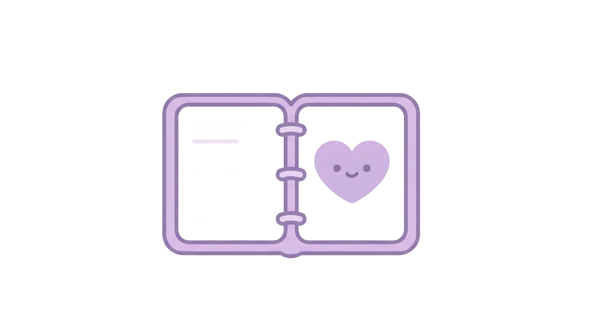

# MoodJournal
Proyecto de Michelle Lozano

1. Create the front-end structure for a web app called MoodJournal using only HTML, CSS and JavaScript (no frameworks). Do NOT add Firebase or API calls yet, only the layout and basic UI behavior.

Files: index.html, app.html, contact.html, style.css (shared), and an empty script.js placeholder for each page (index.js, app.js, contact.js).

Design: soft purple and white color palette, cute and colorful style with emojis, rounded corners, soft shadows, friendly font from Google Fonts. Fully responsive (mobile and desktop). All text in English. Define the colors as CSS variables.

Shared navbar (on app.html and contact.html): logo placeholder (use a small img tag pointing to assets/logo.png with a 🌸 emoji as temporary fallback) + the name "MoodJournal", links "Journal" and "Contact", and a "Logout" button.

index.html: centered card with tabs "Login" and "Sign Up". Login has email and password. Sign Up has email, password and confirm password. Tabs switch with JavaScript. Include an empty area to show error messages.

app.html: a title, a textarea "How are you feeling today?", a button "Analyze my mood", and a result card (hidden until there is a result) showing a big emoji with a heartbeat CSS animation (grows and shrinks), the mood name, and a supportive message. Below it, a section "My past entries" showing a list of cards (date, text, mood emoji). Add a few fake example entries with JavaScript just to preview the design.

contact.html: a contact form with name, email and message, a "Send" button, and a "Thank you" message that appears after submitting (JavaScript only, no backend yet).

Add comments in the code explaining each section.

2. Update the existing MoodJournal front-end (index.html, app.html, contact.html, style.css, and the page JS files). Keep the soft purple and white cute style. Do NOT add Firebase or API calls yet.

1. Guest access: turn index.html into a welcome page. Show a friendly headline, a short description, and a big button "Start journaling" that goes to app.html without requiring login. Below it, show a smaller section "Want to save your history? Log in or sign up" with the existing Login / Sign Up tabs and forms (keep it as optional).

2. app.html must work for guests. In the "My past entries" section, if the user is not logged in, show a friendly message: "Log in to save and see your past entries 💜" with a Login button that goes to index.html. Keep the fake example entries only when a variable isLoggedIn is true (set it to false by default for now).

3. Navbar: remove the 🌸 emoji next to the name. Show only the text "MoodJournal" (keep an img placeholder prepared for assets/logo.png that is hidden if the file does not exist). Show a "Login" button when the user is a guest and a "Logout" button when logged in (use the isLoggedIn variable for now).

4. Emoji rain background on ALL pages: create a shared effects.js that makes emotion emojis (😊 😢 😡 😨 😲 😌 😍 😴) fall slowly from the top to the bottom of the screen like soft rain. Slow speed (about 10 to 18 seconds per fall), random horizontal positions, random sizes between 20px and 36px, low opacity (around 0.5), and no more than 20 emojis on screen at once. They must stay behind the content (position fixed, z-index behind, pointer-events none), and must not make text hard to read. Respect prefers-reduced-motion by disabling the animation.

Add comments in the code explaining each part. 

(IMPORVEMENTS- CHANGES DE DESIGN) (Decisión de diseño: Cambié el login obligatorio por un modo invitado con login opcional, para que sea más fácil entrar, sin perder el requisito de Firebase Authentication.)

3. Update the MoodJournal front-end (style.css, effects.js, app.html, app.js). Keep the soft purple and white cute style. Do NOT add Firebase or API calls yet.

1. Emoji rain: make the falling emojis a mix of sizes, from 25px to 90px (random). Keep them slow (10 to 18 seconds per fall), low opacity, behind the content, and limited to about 20 on screen. Make the biggest ones less frequent than the small ones.

2. Typography: increase the font size across the whole app by about 10% (for example by raising the root font-size and using rem units). Check that buttons, inputs, navbar and cards still look balanced and responsive.

3. Mood result card: redesign it. Create a function showMood(moodName) that receives one of: joy, sadness, anger, fear, surprise, disgust, neutral. For each mood it must:
   - change the card background to a soft gradient with its own colors (joy: warm yellow to peach, sadness: soft blue to lavender, anger: soft coral to pink, fear: lilac to gray-purple, surprise: mint to light cyan, disgust: soft green to sage, neutral: lavender to white), with a smooth transition between colors;
   - show a big emoji (about 5rem) with the heartbeat animation (grows and shrinks);
   - show the mood name in large text (for example "Joy");
   - show a supportive message written for that mood (2 sentences, warm and kind);
   - appear with a gentle fade and slide-up animation.
   Keep the text readable on every gradient.

4.
Update app.html and app.js in the MoodJournal project. Do NOT add Firebase or Hugging Face yet.

1. Remove the 7 temporary emoji test buttons under the result card (the ones marked "TEMPORARY").

2. Make the "Analyze my mood" button work. When clicked, it must read the text from the textarea and call a function analyzeMood(text) that returns one of: joy, sadness, anger, fear, surprise, disgust, neutral. Then call the existing showMood(moodName) function with the result.

3. For now, analyzeMood(text) must be a TEMPORARY keyword-based version: convert the text to lowercase and look for keywords.
   - joy: happy, great, good, excited, love, amazing, glad, proud, fun
   - sadness: sad, cry, lonely, down, hurt, miss, depressed, tired of, rain
   - anger: angry, mad, hate, furious, annoyed, upset, frustrated
   - fear: scared, afraid, anxious, nervous, worried, panic, stress
   - surprise: surprised, shocked, wow, unexpected, suddenly
   - disgust: disgusting, gross, nasty, sick of, awful
   - neutral: if no keyword matches.
   Add a comment: "TEMPORARY - replace with Hugging Face emotion model later". Keep analyzeMood as a separate async function so it can be replaced easily.

4.

-----------------------------

4.
Update app.html and app.js in the MoodJournal project. Do NOT add Firebase or Hugging Face yet.

1. Remove the 7 temporary emoji test buttons under the result card (the ones marked "TEMPORARY").

2. Make the "Analyze my mood" button work. When clicked, it must read the text from the textarea and call a function analyzeMood(text) that returns one of: joy, sadness, anger, fear, surprise, disgust, neutral. Then call the existing showMood(moodName) function with the result.

3. For now, analyzeMood(text) must be a TEMPORARY keyword-based version: convert the text to lowercase and look for keywords.
   - joy: happy, great, good, excited, love, amazing, glad, proud, fun
   - sadness: sad, cry, lonely, down, hurt, miss, depressed, tired of, rain
   - anger: angry, mad, hate, furious, annoyed, upset, frustrated
   - fear: scared, afraid, anxious, nervous, worried, panic, stress
   - surprise: surprised, shocked, wow, unexpected, suddenly
   - disgust: disgusting, gross, nasty, sick of, awful
   - neutral: if no keyword matches.
   Add a comment: "TEMPORARY - replace with Hugging Face emotion model later". Keep analyzeMood as a separate async function so it can be replaced easily.

4. If the textarea is empty, do not analyze; show a friendly message under the textarea: "Write a few words first 💜".

5. While analyzing, show a short loading state on the button ("Analyzing... ✨") for about 1 second, then show the result card with its fade and slide-up animation.

------------------------
5. 
Update the MoodJournal front-end (index.html, app.html, contact.html, style.css and the JS files). Keep the soft purple and white cute style. Do NOT add Firebase or Hugging Face yet.

1. Shared navbar on ALL three pages (index.html, app.html, contact.html), fixed at the top and always visible (position sticky or fixed, white background, soft shadow, high z-index above the emoji rain). It contains:
   - On the left: the text "MoodJournal" (with the hidden img placeholder for assets/logo.png). Clicking it must go to index.html.
   - On the right: links "Journal" (app.html) and "Contact" (contact.html), highlighting the current page, plus two buttons: "Login" and "Sign Up".
   - When the variable isLoggedIn is true, replace the Login and Sign Up buttons with a "Logout" button.
   Put the navbar code in a shared navbar.js file that injects the navbar HTML into a <header id="navbar"></header> element, so I do not repeat the same HTML on every page. Make it responsive (on mobile, collapse the links into a simple menu button).

2. index.html: remove the "Want to save your history?" login section from the page body. The page body must show ONLY the centered "Your feelings matter." welcome card with the "Start journaling" button.

3. Make the "Start journaling" button pulse with a heartbeat animation (a gentle grow and shrink loop, with a soft purple glow). Pause the animation on hover and respect prefers-reduced-motion.

4. Auth modal: create a shared modal (also injected by navbar.js) with the Login / Sign Up tabs and the existing forms (email and password for Login; email, password and confirm password for Sign Up; an empty area for error messages). The "Login" button in the navbar opens the modal on the Login tab, and the "Sign Up" button opens it on the Sign Up tab. The modal must close with an X button, by clicking outside it, or by pressing Escape, and it must open with a smooth fade and scale animation. It must work on every page.

5. Make sure the existing "Login" buttons in app.html (past entries area) open the same modal instead of linking to index.html.

Add comments in the code explaining each part.

-------------------------
6.Update the MoodJournal front-end (index.html, app.html, style.css, navbar.js, app.js and a new month.js). Keep the soft purple and white cute style, all text in English. Do NOT add Firebase or Hugging Face yet.

1. Welcome card (index.html): remove the three emojis (rainbow, purple heart, tulip) from the card. Make the card bigger: max-width around 760px, more padding, a larger headline and description, and a bigger "Start journaling" button, while keeping everything centered and responsive.

2. Navbar tab style (navbar.js and style.css): keep the top navbar as it is (logo "MoodJournal" on the left, links on the right, Login/Sign Up or Logout buttons). Restyle the links "Journal" and "Contact" like notebook divider tabs: rounded top corners, each tab with its own soft pastel color (for example lavender and pink), a slight lift on hover, and the active page's tab looks raised with a stronger color. Keep it responsive and make sure the navbar stays visible above the emoji rain.

3. "My month in colors" card (app.html, below the mood result and above "My past entries"): create a card with the title "My month in colors", the subtitle "A tracker to color your mood each day of the month.", a row of small heart previews, and an "Open" button on the right. Clicking "Open" expands the card (smooth animation) to show the full calendar of the current month: a grid with one heart per day, with the day number under each heart, and week day labels (Mon to Sun). The button then says "Close".
   - Clicking a heart opens a small popup palette to choose that day's color. Colors and names: Joy (soft yellow), Sadness (soft blue), Anger (soft coral), Fear (lilac), Surprise (mint), Disgust (soft green), Neutral (lavender), plus a "Clear" option to remove the color.
   - Add previous and next month arrows with the month and year in the header, and a small legend showing each color with its mood name.
   - The days without a color are shown as empty light hearts. Today's heart has a small highlight.
   - Save the data in localStorage under keys like "moodjournal_month_YYYY-MM" (an object with day number -> mood name) so it works for guests and remains after reloading. Write the saving and loading in separate functions (saveMonthData, loadMonthData) so they can later be synced with Firebase Firestore for logged-in users.
   - Put this code in month.js and include it in app.html.

Add comments in the code explaining each part.

----------------------
7. Update navbar.js and style.css in the MoodJournal project.

Restyle the "Login" and "Sign Up" buttons in the navbar so they look exactly like the "Journal" and "Contact" notebook divider tabs: same size, same font, same padding, same rounded top corners, same lift on hover, and same alignment with the other tabs. Give each one its own soft pastel color so all four tabs look like a matching set (for example Journal: lavender, Contact: pink, Login: soft blue, Sign Up: soft mint). Remove the white outlined style from Login and the solid dark purple style from Sign Up.

They must still open the auth modal (Login tab and Sign Up tab) when clicked. When isLoggedIn is true, the "Logout" button must use the same tab style too. Keep the layout responsive, and keep the navbar visible above the emoji rain.

Add comments in the code explaining the change.

--------------------------------

7. Update app.html, app.js and style.css in the MoodJournal project. Keep the soft purple and white cute style, all text in English. Do NOT add Firebase or Hugging Face yet.

Redesign the journal entry card (the one with the textarea and the "Analyze my mood" button) to look like a page from a paper notebook. Keep the existing result card, month tracker and past entries below it.

1. Top of the card: a small pill-shaped label that says "TODAY" (soft purple background, rounded, uppercase small text).

2. "How I'm arriving today": a row of 5 circular buttons, a mood scale from 1 to 5, each with an emoji (1: 😢, 2: 😕, 3: 😐, 4: 🙂, 5: 😄) and a small tooltip or label on hover. Only one can be selected at a time; the selected one gets a purple border, a soft fill and a small scale-up. Store the selected value in a variable called arrivingMood (null if none).

3. "Things I want to write about": a checklist of 5 rows. Each row has a round or square checkbox on the left and a text input on the right styled as a thin line (only a bottom border, like a notebook line). Checking a box visually strikes through the text.

4. Main writing area: keep the textarea (label "How are you feeling today?") but style it as lined paper: a soft cream-lavender background with thin horizontal lines (use repeating-linear-gradient with a line height that matches the textarea line-height), no visible box border, and a soft left margin line.

5. "A question for myself": a single input styled as a notebook line, placeholder "Write a question you want to think about..."

6. Keep the "Analyze my mood" button at the bottom of the card. When clicked, build ONE combined string with: the main text + the text of every topic row that is not empty + the question, separated by spaces, and pass it to the existing analyzeMood(text) function. If all those fields are empty, show the friendly message "Write a few words first 💜" like before. Do not change analyzeMood itself.

7. Make the card responsive (the 5 circles and the checklist must look good on mobile) and keep the heartbeat result animation working.

Add comments in the code explaining each part.

----------------------

8.Update the MoodJournal front-end (index.html, app.html, contact.html, style.css, navbar.js, effects.js). Keep the soft purple and white cute style, all text in English. Do NOT add Firebase or Hugging Face yet.

1. Welcome page (index.html): remove the text "A little space just for you ✨" above the headline.

2. Readability: the text across the whole site is too small. Increase the font size noticeably: raise the root font-size so the base body text is about 18px to 19px on desktop, labels and helper texts at least 15px (nothing smaller), buttons and inputs at least 17px, headings scaled proportionally, and the welcome headline bigger. Use rem units so everything scales together, and check that cards, forms, the month tracker and the emoji result still look balanced and responsive on desktop and mobile.

3. Navbar: make it bigger. Increase the height and padding, make the "MoodJournal" text bigger and bolder, and make the tabs larger (font about 17px to 18px, more padding) while keeping the notebook divider tab style and colors.

4. Remove the "Login" tab from the navbar. Keep "Sign Up" (it opens the auth modal, which still has the Login and Sign Up tabs inside). Keep the "Logout" tab for when isLoggedIn is true. The other "Login" buttons on the site must still open the auth modal.

5. Logo spot: in the navbar, put an  (about 44px tall) to the left of the "MoodJournal" text, inside the same link that goes to index.html. If the image fails to load, hide it without leaving a broken icon.

6. Emoji rain pause button (all pages): add a round, semi-transparent button (glass effect, soft purple border, blur background) fixed at the top-right corner of the screen, just below the navbar. It shows ⏸ when the rain is playing and ▶ when paused, with an aria-label and a tooltip ("Pause background animation" / "Play background animation"). Clicking it pauses or resumes the falling emojis (pause the CSS animations and stop creating new emojis). Save the choice in localStorage and apply it when any page loads. Put the logic in effects.js and inject the button from there so it appears on every page.

7. Footer on all pages: replace "Made with care, for all your feels 💜" with "Made with 💜 by @Michelle Lozano and Codex" (make the text larger and easy to read).

Add comments in the code explaining each part.

-------------------
9.Update app.html, app.js and style.css in the MoodJournal project. Keep the same style, all text in English. Do NOT add Firebase or Hugging Face yet.

1. Remove the text "Your daily check-in 🌷" above the title "How are you feeling?".

2. In the journal entry card, change the "How are you feeling today?" writing area: remove the horizontal lines (the lined paper background) and instead make it a clearly visible rectangular box: white background, a 2px soft purple border, rounded corners (about 14px), inner padding, a soft shadow, a minimum height of about 200px, and a stronger purple border with a gentle glow when focused. Keep the textarea label above it.

3. Keep everything else in the card (TODAY label, mood scale, checklist, question line, Analyze button) working as before.

4. Readability: make the labels, placeholders and typed text in this card larger and darker so they are easy to read (typed text about 18px to 19px, placeholders in a darker gray-purple with enough contrast, labels bold and larger). Also increase the text size and contrast in the result card, the "My month in colors" card and the "My past entries" section.

Add comments in the code explaining each part.

----------------
 HUGGING FACE 

 Update app.js (and app.html if needed) in the MoodJournal project. Do NOT add Firebase yet.

Connect the "Analyze my mood" button to a Hugging Face emotion model that runs directly in the browser using Transformers.js. No token, API key or server must be used anywhere.

Model: MicahB/emotion_text_classifier (labels: anger, disgust, fear, joy, neutral, sadness, surprise).

Requirements:
1. Create a separate file huggingface.js (ES module) with an async function detectEmotion(text). Load the library from jsDelivr using @xenova/transformers@2.17.2, create the pipeline('text-classification', 'MicahB/emotion_text_classifier') only once and reuse it, and return the label with the highest score in lowercase plus the scores of all 7 labels.
2. Update analyzeMood(text) so it first calls detectEmotion(text). If it fails or takes longer than 90 seconds, use the existing keyword logic as a fallback (keep it as a function called keywordFallback).
3. The first time, the model downloads. Show the message "Waking up the AI, the first time can take a moment 💜" under the card, and start loading the model in the background when app.html opens.
4. If the fallback was used, show a small note: "Analyzed with the keyword helper".
5. Keep showMood(moodName), the gradients, the emoji animation and the month tracker working as before.
6. Add try/catch with console.error messages and comments explaining each part.

Capacidad usada: Transformers.js con el modelo MicahB/emotion_text_classifier (https://huggingface.co/MicahB/emotion_text_classifier).
Razón: detecta la emoción de lo que la persona escribe para mostrar un mensaje de apoyo que encaja con cómo se siente, algo que las palabras clave no logran.
Prompts 14 y 15: (los de arriba) + qué hizo cada uno.
Problema: Gradio estaba como "Paid". Solución: usé Transformers.js en el navegador. Después, la primera carga se sentía lenta, pero el modelo queda en caché y luego es rápido.